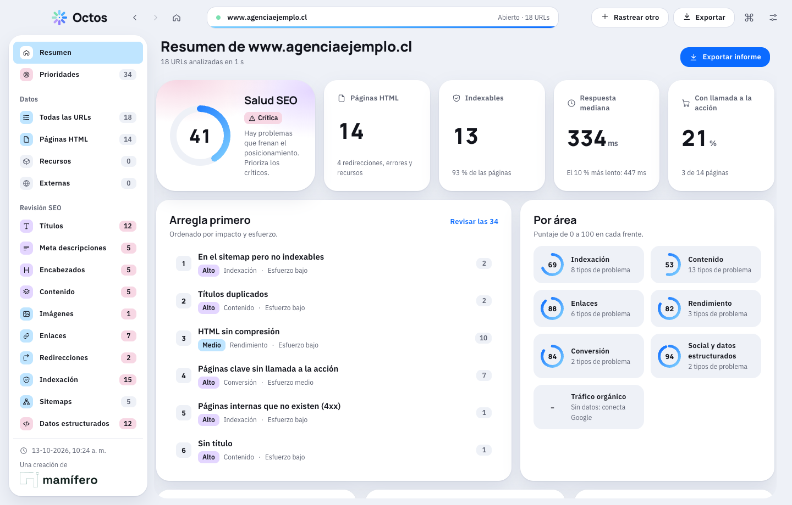
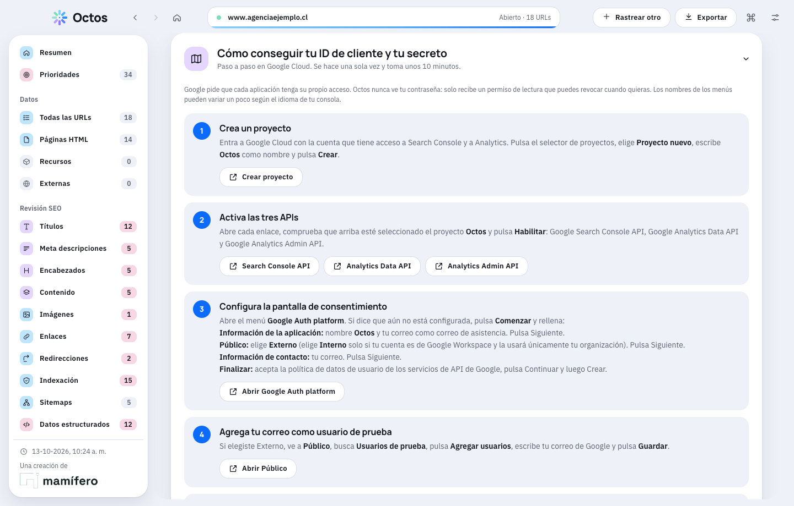

# Octos

Crawler y análisis de SEO para Mac y Windows. Rastrea un sitio como lo haría Google y te entrega un plan de acción ordenado por impacto y esfuerzo, con explicaciones claras.

Una creación de [Mamífero](https://mamiferolab.com/).



## Qué hace

**Rastreo y análisis**
- Cola con concurrencia, robots.txt, sitemaps (índices y .gz), redirecciones paso a paso, enlaces externos opcionales, patrones de inclusión y exclusión, y varios user-agents (Googlebot, Bingbot…).
- Renderizado de JavaScript con el Chromium de Electron: compara el HTML original con el renderizado y marca el contenido que depende de JS.
- 69 reglas en 7 áreas (indexación, contenido, enlaces, rendimiento, conversión, social y datos estructurados, tráfico orgánico). Cada una explica por qué importa y cómo corregirla, con severidad y esfuerzo.
- Puntaje de salud de 0 a 100, puntaje por área y lista «Arregla primero». Compara con el rastreo anterior del mismo dominio.
- Conversión: llamadas a la acción en páginas clave, formularios largos o sin etiquetas, contacto directo.
- Contenido duplicado y casi duplicado; títulos y descripciones medidos en píxeles, con vista previa del resultado en Google.

**Conexiones opcionales** (las claves se guardan cifradas en tu equipo y nunca llegan a la interfaz)
- **Google Search Console y Analytics 4**: clics, impresiones, CTR, posición, consultas, visitas y eventos clave por URL; inspección de URL bajo demanda. Incluye un paso a paso para crear tu cliente OAuth de escritorio en Google Cloud.
- **Lighthouse por URL**: local con el Chrome instalado (sin clave) o con PageSpeed Insights (datos reales de usuarios).
- **IA con tu propia clave**: Claude, OpenAI y cualquier servicio compatible con la API de OpenAI (Gemini, Groq, Mistral, OpenRouter, DeepSeek, Ollama local…).

**Exportación**
- **PowerPoint** con la marca: estado, prioridades y plan de acción en tres horizontes, con notas del orador.
- **Excel**, CSV por vista, informe HTML para compartir, sitemap XML limpio y archivos `.octos` para reabrir un rastreo.



## Instalación

Descarga el instalador de tu sistema desde la [última versión](https://github.com/rcorne/octos/releases/latest). Más información en [mamiferolab.com/octos](https://www.mamiferolab.com/octos).

| Sistema | Archivo |
| --- | --- |
| Mac con chip Apple (M1 o posterior) | `Octos-<versión>-arm64.dmg` |
| Mac con chip Intel | `Octos-<versión>-x64.dmg` |
| Windows 10 u 11 (64 bits) | `Octos-<versión>-Setup-x64.exe` |

Los instaladores **no están firmados** con un certificado de Apple ni de Microsoft, así que cada sistema muestra un aviso la primera vez:

- **Mac:** abre el `.dmg`, arrastra Octos a Aplicaciones, haz clic derecho sobre la app y elige **Abrir**. Si macOS la bloquea, ve a Ajustes del Sistema → Privacidad y seguridad y pulsa **Abrir de todos modos**.
- **Windows:** si aparece «Windows protegió su PC», pulsa **Más información** y luego **Ejecutar de todas formas**.

Es normal en apps independientes. Guía: [mamiferolab.com/apps](https://www.mamiferolab.com/apps#como-abrir-apps).

## Compilar desde el código

Necesitas [Node.js](https://nodejs.org/) 22 o superior y Git. Para el instalador de Mac (`.dmg`) hace falta un Mac.

```bash
git clone https://github.com/rcorne/octos.git
cd octos
npm install
npm start                  # abre Octos en modo desarrollo
npm test                   # corre todas las pruebas
```

```bash
npm run package            # Mac Apple Silicon: out/Octos-<versión>-arm64.dmg
npm run package:mac-intel  # Mac Intel:         out/Octos-<versión>-x64.dmg
npm run package:win        # Windows:           out/windows/Octos-<versión>-Setup-x64.exe
```

Al subir una etiqueta (`git tag v1.0.0 && git push --tags`), GitHub Actions compila los tres instaladores y los publica en Releases.

## Estructura

- `main.js`, `preload.js`: ventana, menú, historial, conexiones y exportación. Las credenciales viven solo aquí.
- `lib/`: motor de rastreo, análisis, conexiones (Google, IA, Lighthouse) y exportación a PowerPoint y Excel.
- `renderer/`: interfaz, tokens de diseño y tipografías.
- `assets/`: logotipos, íconos y tipografías de la marca.
- `docs/`: sistema de diseño y contratos entre módulos. `test/`: pruebas y un banco visual con Chrome (`test/preview`).

## Notas

- **Pruebas en Windows:** la versión de Windows se prueba con integración continua en un equipo Windows real de GitHub (motor, Lighthouse con Chrome y cifrado de credenciales), pero no en todas las versiones de Windows. Si algo falla, abre un [issue](https://github.com/rcorne/octos/issues).
- **Servicios externos:** Google, Anthropic, OpenAI y PageSpeed se probaron con servidores falsos y la documentación oficial. La primera conexión de cada uno conviene revisarla con tus propias cuentas.
- **Tipografías en PowerPoint y Excel:** usan Manrope e IBM Plex Sans (licencia OFL, incluidas en `assets/fonts`). Octos puede instalarlas desde Ajustes → Apariencia; en Windows abre la carpeta para que las instales. Sin ellas, Office usa fuentes sustitutas.
- **Marca:** Octos y Mamífero son marcas de sus titulares. La licencia MIT cubre el código.

## Licencia

[MIT](LICENSE) © 2026 Rodrigo Cornejo.
